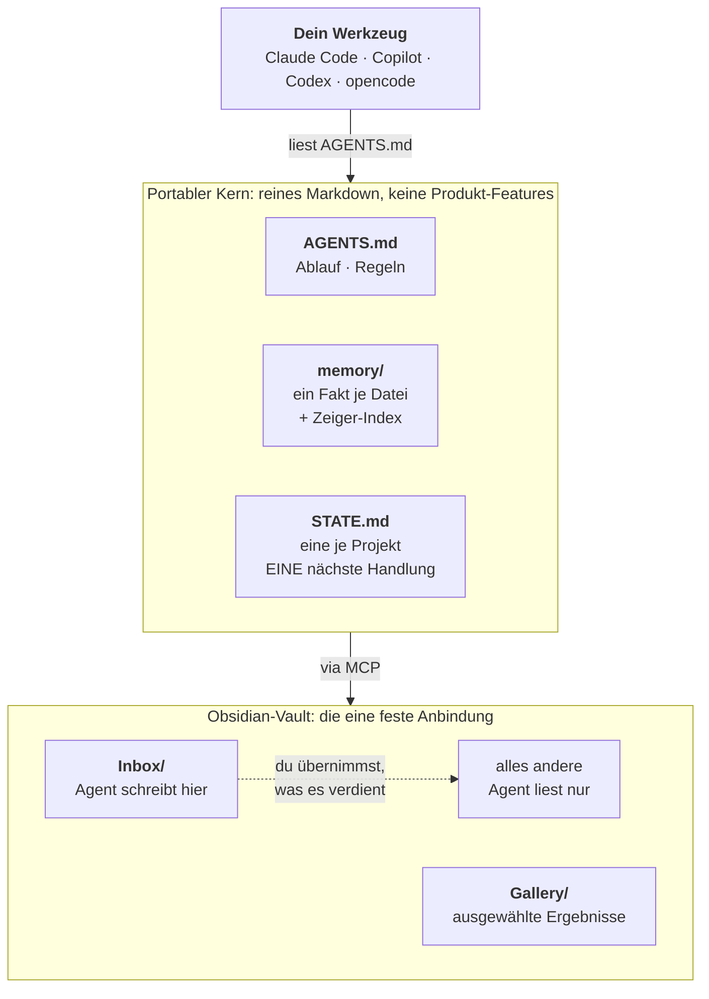

<p align="center">
  <h1 align="center">Agent Orchestrator Starter</h1>
  <p align="center">
    Dauerhaftes Gedächtnis, Projektstände und ein Wissens-Vault für deinen KI-Agenten, als einfache Dateien. Für Claude Code, Codex, GitHub Copilot (Adapter noch Entwurf) und jeden Agenten, der <code>AGENTS.md</code> liest.
  </p>
  <p align="center">
    <a href="https://github.com/janrummel/claude-orchestrator-starter/stargazers"></a>
    <a href="LICENSE"></a>
    
    
  </p>
  <p align="center">
    <a href="https://janrummel.github.io/claude-orchestrator-starter/">🌐 Website</a> ·
    <strong>Deutsch</strong> | <a href="README.md">English</a>
  </p>
</p>

---

**Dein Agent-Setup sollte deine Werkzeugwahl überleben.** Gedächtnis, Projektstand und
Wissensschicht als einfache Dateien, damit sie einen Wechsel von Modell oder Werkzeug
überstehen.

> **Stand (November 2026).** Entstanden aus einem persönlichen Orchestrator, der seit März
> 2026 täglich im Einsatz ist. Der Teil für Claude Code ist dieses tägliche Setup. Der
> werkzeugneutrale Kern kam im November 2026 dazu. Außerhalb von Claude Code lief er in
> **3 echten Arbeitssitzungen, alle mit Codex**: ein Prüfauftrag nur mit Leserechten
> (August 2026), eine Prüfung und eine reine Textänderung der Website dieses Kits
> (November 2026), die letzten beiden mit den Regeln für Projektstand, Inbox und Reibungsprotokoll. Der Copilot-Adapter
> ist noch unerprobt. Siehe [`VALIDATION.md`](VALIDATION.md) und [`STATE.md`](STATE.md).
>
> Bis November 2026 hieß dieses Repo *Claude Orchestrator Starter Kit*. Die Adresse bleibt
> gleich, und jede Datei aus dieser Fassung liegt noch an ihrem Platz.

**Für wen:** für Einzelne, die täglich mit einem KI-Agenten arbeiten und wollen, dass ihr
Setup einen Werkzeugwechsel übersteht. Nicht im Team erprobt, kein Support. Drei Begriffe:
*Werkzeug* (englisch *harness*) = das Agent-Programm, etwa Claude Code, Copilot, Codex;
*Adapter* = Hinweise und Konfiguration für ein Werkzeug; *MCP* = das Standardprotokoll, mit
dem Agenten andere Programme wie einen Obsidian-Vault erreichen.

Die englische Fassung [`README.md`](README.md) ist ausführlicher (Schleifen, FAQ, Beispiel-Sitzung).

## Die Idee auf einem Schirm



Drei Dateien tragen das Ganze. Dein Werkzeug liest sie, dein Vault behält, was bleibt,
und du entscheidest, was hineinkommt.

## Das Problem

| Ohne | Mit |
|---|---|
| Jede Sitzung beginnt bei null, du erklärst denselben Kontext neu. | Der Agent öffnet `STATE.md` und weiß, wo du aufgehört hast. |
| Dein Setup lebt im Konfigurationsformat eines Anbieters. | Es lebt in Markdown, das du überallhin kopierst. |
| Werkzeugwechsel heißt Arbeitsweise neu bauen. | Drei Dateien kopieren, weiterarbeiten. |
| Entscheidungen liegen in Chatverläufen, die niemand durchsucht. | Entscheidungen liegen neben der Arbeit, mit Begründung. |
| Du glaubst, deine Regeln werden durchgesetzt. | Du weißt, welche durchgesetzt und welche nur erbeten sind. |

## Schnellstart

### Jedes Werkzeug (Copilot, Codex, opencode, ...)

```bash
# 1. Klonen
git clone https://github.com/janrummel/claude-orchestrator-starter.git
cd claude-orchestrator-starter

# 2. Einrichten: den Anweisungskern ins eigene Projekt legen
mkdir -p ~/dein-projekt/memory
cp AGENTS.md.example ~/dein-projekt/AGENTS.md
cp core/memory/MEMORY.md.example ~/dein-projekt/memory/MEMORY.md
cp core/projects/STATE.md.template ~/dein-projekt/STATE.md

# 3. Loslegen: Agent in dem Ordner öffnen und sagen
#    "Lies memory/MEMORY.md und STATE.md, dann mach weiter."
```

Hinweise je Werkzeug (MCP-Konfiguration, was es durchsetzen kann) stehen in
[`adapters/`](adapters/README.md). Erst sehen, dann installieren?
[`examples/first-session.md`](examples/first-session.md) spielt eine durchgerechnete, erfundene Aufgabe durch.

### Claude Code

```bash
git clone https://github.com/janrummel/claude-orchestrator-starter.git
cd claude-orchestrator-starter

cp CLAUDE.md.example ~/.claude/CLAUDE.md   # überschreibt eine vorhandene Datei: vorher sichern
cp AGENTS.md.example ~/.claude/AGENTS.md   # der werkzeugneutrale Kern, CLAUDE.md verweist darauf
cp -r orchestrator/ ~/.claude/orchestrator/
mkdir -p ~/.claude/skills && for d in ~/.claude/orchestrator/skills/*/; do ln -sfn "$d" ~/.claude/skills/"$(basename "$d")"; done   # Claude Code sucht Skills in ~/.claude/skills/
mkdir -p ~/.claude/memory ~/.claude/orchestrator/projects
cp core/memory/MEMORY.md.example ~/.claude/memory/MEMORY.md   # ein Fakt je Datei; alte memory/-Ordner? behalten

# Hooks (Statuszeile, Kontextanzeige, Sitzungsverkettung) müssen in ~/.claude/settings.json
# eingetragen werden: Schritt 3 in docs/getting-started.md.

claude
```

Noch nicht geprüft: eine frische Installation nur nach diesen Schritten auf einem leeren Rechner (siehe [`STATE.md`](STATE.md)).

Bei Claude Code *können* Hooks Regeln durchsetzen statt nur erbitten. Mitgeliefert sind
Hooks für Sitzungsverkettung (`claude-loop`) und Kontextanzeige
([`hooks/README.md`](hooks/README.md)); was sonst möglich und was mitgeliefert ist, steht in
[`docs/portability.md`](docs/portability.md). Schritt für Schritt:
[`docs/getting-started.md`](docs/getting-started.md).

## Die ehrliche Grenze

Eine Markdown-Regel ist eine **Bitte**. Nur ein Werkzeug mit Hooks oder Sperrregeln macht
daraus etwas **Durchgesetztes**. Ohne Adapter läuft alles auf Disziplin, und das Kit sagt
das ausdrücklich.

Warum das wichtig ist: In einer Prüfung des persönlichen Setups, aus dem dieses Kit
stammt, waren sechs Mechanismen vorhanden, eingerichtet und für wirksam gehalten. Darunter
eine Auslieferungssperre, die 8 Tage lang nichts tat, während ihre eigenen Tests grün
waren, und ein Protokoll, das 20 von 28 Runden leer speicherte. Alle Zahlen mit Herkunft:
[`docs/evidence.md`](docs/evidence.md) (englisch).

Deshalb prüft sich dieses Repo selbst:

```bash
bash scripts/check-kit.sh            # Pflichtdateien da, jeder relative Link löst auf
bash scripts/check-depersonalized.sh # keine persönlichen Angaben in den Dateien
```

## Acht Skills

Jeder Skill ist eine `SKILL.md`: **Anweisungen, kein Code**. Claude Code lädt sie als
Skills, andere Agenten lesen sie als Anweisungen.

| | Skill | Zweck | Du sagst ... |
|---|-------|---------|-----------|
| 📥 | **capture** | Schnell festhalten | „Notiere das“, „Halte die Idee fest“ |
| 🔬 | **distill** | Zusammenfassen und verdichten | „Fasse zusammen“, „Kernpunkte“ |
| ✍️ | **express** | Fertige Texte schreiben | „Schreibe“, „Entwirf“, „Formuliere“ |
| 🔍 | **analyze** | Strukturierte Analyse | „Analysiere“, „Untersuche“ |
| 🎯 | **signal-check** | Qualitäts- und Faktencheck | „Hält das?“, „Prüfe die Qualität“ |
| ⚔️ | **challenge** | Gezielt angreifen, Schwächen finden | „Was kann schiefgehen?“, „Stresstest“ |
| 🛡️ | **quality-gate** | Prüfstufen für Ergebnisse steuern | „Prüf das“, „Stimmt das?“ |
| 💾 | **handoff** | Stand für die nächste Sitzung sichern | „Sichere den Stand“, „Übergabe“ |

Jede Aufgabe läuft durch drei Phasen: **Klären** (analyze, distill), **Machen** (express,
capture), **Prüfen** (signal-check, quality-gate, challenge). Eigene Skills:
[`docs/skill-development.md`](docs/skill-development.md).

## Datenschutz

- **Das Kit selbst betreibt keinen Server und sammelt nichts.** Gedächtnis, Projektstände und Protokolle liegen als Dateien auf deinem Rechner; keine Telemetrie, keine Analyse.
- **Dein Agent-Werkzeug ist nicht lokal.** Claude Code, Copilot und Codex schicken alles, was der Agent liest, auch Gedächtnis und Vault-Notizen, an ihren Anbieter, zu dessen Bedingungen. Sensibles gehört nicht in Dateien und Vault-Bereiche, die der Agent lesen darf.
- **Die Vault-Anbindung startet `npx`-Pakete** (einen MCP-Server). Die geprüfte Version festlegen, statt bei jedem Start die neueste zu laden.
- **Keine API-Keys** für das Kit selbst. Nur dein Agent-Werkzeug braucht ein eigenes Konto.
- **Dir gehört alles.** Exportieren, sichern oder löschen jederzeit.

Die Website auf GitHub Pages lädt ihre Schriften von Google Fonts.

## Weiter

| Du willst | Datei |
|---|---|
| das Repo in fünf Minuten verstehen | [`START_HERE.md`](START_HERE.md) |
| es benutzt sehen | [`examples/first-session.md`](examples/first-session.md) |
| auf Copilot oder Codex installieren | [`adapters/`](adapters/README.md) |
| auf Claude Code installieren | [`docs/getting-started.md`](docs/getting-started.md) |
| wissen, warum jede Regel so ist | [`docs/rationale.md`](docs/rationale.md) |
| Obsidian anbinden | [`obsidian/README.md`](obsidian/README.md) |
| die frühere Gedächtnis-Ablage nach Ordnern | [`memory/README.md`](memory/README.md) |
| alle Details, Architektur, FAQ | [`README.md`](README.md) (englisch) |

## Veröffentlichung

https://janrummel.github.io/claude-orchestrator-starter/ wird von GitHub Pages direkt aus
dem Branch `main`, Ordner `/docs`, ausgeliefert. Kein Build-Schritt: die Dateien sind
statisches HTML, CSS und JavaScript.

## Lizenz und Mitmachen

[MIT](LICENSE). Am meisten hilft eine Zeile Reibung aus echter Nutzung, siehe
[CONTRIBUTING.md](CONTRIBUTING.md).
