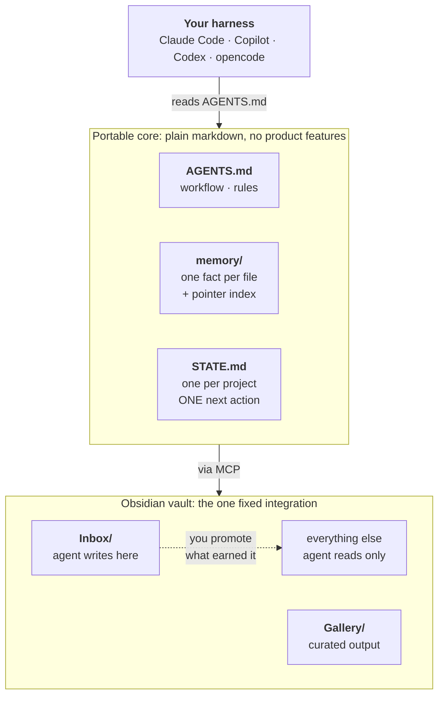
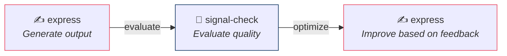
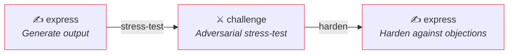
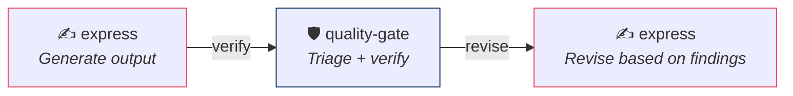
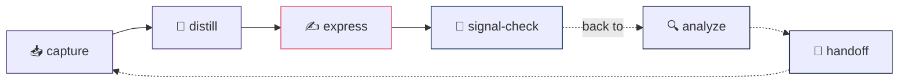

<p align="center">
  <h1 align="center">Agent Orchestrator Starter</h1>
  <p align="center">
    Persistent memory, project states and a knowledge vault for your AI agent, as plain files. For Claude Code, Codex, GitHub Copilot (adapter still a draft) and any agent that reads <code>AGENTS.md</code>.
  </p>
  <p align="center">
    <a href="https://github.com/janrummel/claude-orchestrator-starter/stargazers"></a>
    <a href="LICENSE"></a>
    
    
  </p>
  <p align="center">
    <a href="https://janrummel.github.io/claude-orchestrator-starter/">🌐 Website</a> ·
    <a href="README.de.md">Deutsch</a> | <strong>English</strong>
  </p>
</p>

---

**Your agent setup should outlive your choice of vendor.** Memory, project state and a
knowledge layer as plain files, so they survive a change of model or tool.

> **Status (November 2026).** Extracted from a personal orchestrator in daily use since
> March 2026. The Claude Code part is that daily setup. The vendor-neutral core was
> merged in November 2026. Outside Claude Code it has run in **3 real-work sessions, all on
> Codex**: a read-only audit (August 2026), a website audit and a text-only edit of this kit's own
> website (November 2026), the last two with the state, inbox and friction-log rules in use. The
> Copilot adapter is still untested. See [`VALIDATION.md`](VALIDATION.md) and [`STATE.md`](STATE.md).
>
> This repository was called *Claude Orchestrator Starter Kit* until November 2026. The
> address stays the same and every file from that version is still where it was.

**Who it is for:** individuals who work with an AI agent every day and want their setup to
survive a change of tool. Not tested in teams, no support. Three words used throughout:
*harness* = the agent tool you use (Claude Code, Copilot, Codex); *adapter* = the notes and
config for one harness; *MCP* = the standard protocol agents use to reach outside tools such
as an Obsidian vault.

## The idea in one screen



Three files carry the whole thing. Your harness reads them, your vault stores what
survives, and you stay the curator.

## The problem

| Without this | With this |
|---|---|
| Every session starts at zero. You re-explain the same context. | The agent opens `STATE.md` and knows where you stopped. |
| Your setup lives in one vendor's config format. | It lives in markdown you can copy anywhere. |
| Switching tool or model means rebuilding your workflow. | Copy three files, keep working. |
| Decisions live in chat history you cannot search. | Decisions live next to the work, with their reasons. |
| You believe your rules are enforced. | You know which ones are, and which are only requested. |

## Quick start

### Any agent (Copilot, Codex, opencode, ...)

```bash
# 1. Clone
git clone https://github.com/janrummel/claude-orchestrator-starter.git
cd claude-orchestrator-starter

# 2. Configure: put the instruction core into your project
mkdir -p ~/your-project/memory
cp AGENTS.md.example ~/your-project/AGENTS.md
cp core/memory/MEMORY.md.example ~/your-project/memory/MEMORY.md
cp core/projects/STATE.md.template ~/your-project/STATE.md

# 3. Run: open your agent in that folder and say
#    "Read memory/MEMORY.md and STATE.md, then continue."
```

That is the whole installation. Harness-specific notes (MCP config, what your harness
can enforce) live in [`adapters/`](adapters/README.md). Want to see it used before you
install it? [`examples/first-session.md`](examples/first-session.md) walks one worked,
fictional task end to end.

### Claude Code

> **Time:** ~5 minutes | **Prerequisites:** [Claude Code](https://docs.anthropic.com/en/docs/claude-code) + a terminal

```bash
# 1. Clone
git clone https://github.com/janrummel/claude-orchestrator-starter.git
cd claude-orchestrator-starter

# 2. Copy to your Claude config
cp CLAUDE.md.example ~/.claude/CLAUDE.md   # overwrites an existing file: back yours up first
cp AGENTS.md.example ~/.claude/AGENTS.md   # the vendor-neutral core, referenced from CLAUDE.md
cp -r orchestrator/ ~/.claude/orchestrator/
mkdir -p ~/.claude/skills && for d in ~/.claude/orchestrator/skills/*/; do ln -sfn "$d" ~/.claude/skills/"$(basename "$d")"; done   # Claude Code looks for skills in ~/.claude/skills/
mkdir -p ~/.claude/memory ~/.claude/orchestrator/projects
cp core/memory/MEMORY.md.example ~/.claude/memory/MEMORY.md   # one fact per file; already using the older memory/ folders? keep them

# 3. Hooks (status line, context monitor, session chaining) need to be registered in
#    ~/.claude/settings.json: follow step 3 of docs/getting-started.md.

# 4. Start Claude Code
claude
```

Not yet verified: a fresh install from these steps alone on a clean machine (see [`STATE.md`](STATE.md)).

Claude will now:
- **Read `CLAUDE.md`** at startup and understand its role
- **Route your requests** to matching skills
- **Remember context** across sessions via memory files

On Claude Code, hooks *can* turn rules into blocks instead of requests. This kit ships hooks for session chaining and context monitoring only; [`docs/portability.md`](docs/portability.md) lists what else is possible and what is shipped.

### Session Chaining (CLI)

When context fills up, you no longer need to open a new terminal. Once the hooks are registered (step 3 of [`docs/getting-started.md`](docs/getting-started.md)) and `claude-loop` is on your PATH:

```bash
# Use claude-loop instead of claude
claude-loop

# When context gets critical, Claude saves state automatically.
# Press Y to start a fresh session; it picks up where you left off.
```

See [hooks/README.md](hooks/README.md) for setup details.

### Optional Add-ons

<details>
<summary>🟣 Obsidian Integration</summary>

Connect your [Obsidian](https://obsidian.md) vault as Claude's knowledge base. Skills like `capture` write to it, `analyze` and `express` read from it.

See [Obsidian Setup](obsidian/README.md) for instructions.
</details>

<details>
<summary>🗃️ Knowledge Database (SQLite)</summary>

For structured data storage (research items, imported datasets, skill usage stats).

See [Knowledge DB Setup](knowledge-db/README.md) for instructions.
</details>

## Architecture

Five layers, all replaceable; Obsidian is the one vault we recommend, and it is optional:

| Layer | File | What it does | Portable? |
|---|---|---|---|
| Instructions | `AGENTS.md` | workflow, rules, quality principles | yes, de-facto standard |
| Memory | `memory/` | one fact per file, index holds pointers only | yes, plain files |
| Project state | `STATE.md` per project | ONE next action, status, decisions with reasons | yes, plain files |
| Knowledge | Obsidian vault via MCP | long-term store, agent writes to two zones only | yes, MCP is universal |
| Enforcement | harness hooks | turns requests into blocks | **no, adapter only** (Claude Code: [`hooks/`](hooks/README.md)) |

The last row is the honest part. See [`docs/portability.md`](docs/portability.md).

## Components

| Component | Purpose | Start at |
|---|---|---|
| [`AGENTS.md.example`](AGENTS.md.example) | the instruction core | copy it, edit the WIP limit |
| [`core/memory/`](core/memory/README.md) | memory convention + templates | the README there |
| [`core/projects/`](core/projects/README.md) | project state convention | `STATE.md.template` |
| [`obsidian/`](obsidian/README.md) | vault via MCP, write zones | `mcp-config.json.example` |
| [`adapters/`](adapters/README.md) | per-harness install + limits | pick your harness |
| [`docs/rationale.md`](docs/rationale.md) | why each rule exists, when to break it | read before disagreeing |
| [`orchestrator/skills/`](orchestrator/skills/) | eight skills as plain markdown procedures | the table below |
| [`CLAUDE.md.example`](CLAUDE.md.example), [`hooks/`](hooks/README.md) | the Claude Code adapter: routing, session chaining, context monitor | [`docs/getting-started.md`](docs/getting-started.md) |
| [`docs/evidence.md`](docs/evidence.md) | measured findings: why a rule that exists is not a rule that works | the first table |
| [`knowledge-db/`](knowledge-db/README.md) | optional SQLite store | only if you miss it |
| [`scripts/check-kit.sh`](scripts/check-kit.sh) | the repo checks itself | run it |

## Workflow: clarify, build, verify

Every task follows three phases, and none is skipped:

```
  Clarify              Build               Verify
  ─────────────────    ─────────────────    ─────────────────
  What's the problem?  Produce the output   Is it good enough?

  analyze              express              signal-check
  distill              capture              quality-gate
                                            challenge
```

This prevents aimless skill-chaining. Each skill belongs to a phase, and each phase has a clear question to answer before moving on.

## Eight skills

Each skill is a `SKILL.md` file: **instructions, not code**. They tell the agent how to behave, what tools to use, and what output to produce.

| | Skill | Purpose | You say... |
|---|-------|---------|-----------|
| 📥 | **capture** | Quick note-taking | "Note this", "Save this idea" |
| 🔬 | **distill** | Summarize and condense | "Summarize", "Key takeaways" |
| ✍️ | **express** | Write polished output | "Write", "Draft", "Formulate" |
| 🔍 | **analyze** | Deep analysis with structured thinking | "Analyze", "Investigate" |
| 🎯 | **signal-check** | Quality check / fact check | "Is this solid?", "Quality check" |
| ⚔️ | **challenge** | Adversarial stress-testing | "What could go wrong?", "Stress-test this" |
| 🛡️ | **quality-gate** | Output quality orchestration | "Check this", "Is this accurate?" |
| 💾 | **handoff** | Save session state for next time | "Save state", "Handoff" |

Claude Code loads them as skills. Other agents read them as instructions when `AGENTS.md` points to them; how well that works across tools is phase 2 of the [build phases](docs/specs/2026-08-03-agnostic-starter-kit-design.md#build-phases).

### Four loops

These 8 skills form four powerful feedback loops:

**Evaluator-Optimizer Loop**: Write, evaluate, improve:



**Evaluator-Challenger Loop**: Write, stress-test, harden:



**Evaluator-Gate-Optimizer Loop**: Write, verify with triage, improve:



**Knowledge Cycle**: Capture, process, output, verify:



## Why the checks matter

The kit is built on one finding: **a rule that exists is not a rule that works.** In an
audit of the maintained personal setup this kit comes from, six mechanisms were present,
configured and believed to work. Among them a delivery gate that stayed silent for 8
days while its own tests were green, and a logger that persisted 20 of 28 rounds empty.
Every figure, with how it was found: [`docs/evidence.md`](docs/evidence.md).

That is why this repo checks itself, and why every adapter says plainly what its tool
can enforce and what it can only ask for.

## Extending it

**Change a rule.** Every rule in `AGENTS.md.example` is meant to be edited. Read its
reason in [`docs/rationale.md`](docs/rationale.md) first, then change it on purpose.

**Add an adapter.** After you have used the core on a harness for real work, copy the
shape of [`adapters/codex/README.md`](adapters/codex/README.md): install steps, what the
harness cannot do, and the friction that actually cost you time. Not before, because the
value of an adapter is its honest limits section.

**Add a skill.** See the [Skill Development Guide](docs/skill-development.md).

**Add a check.** `scripts/check-kit.sh` is plain bash with a `REQUIRED` array. If you add
a rule the repo should keep, add the check and then break it on purpose to prove it goes
red.

## Starter vs. a full system

This kit is the foundation, not a finished orchestrator.

| | This starter | A grown system |
|---|---|---|
| Instructions | one `AGENTS.md` | layered context, extracted procedures |
| Skills | eight, plain markdown | a library of reusable procedures |
| Enforcement | requested only; on Claude Code a few hooks | hooks, deny rules, stop gates |
| Validation | manual | evaluator and critic subagents, logged verdicts |
| Audit | two self-check scripts | scored against a rubric, tracked over time |

Each next phase is built only after the previous one has been used for real work. See
[`STATE.md`](STATE.md) for where that stands.

## Example Session

Illustrative session on Claude Code (made-up project and numbers; a complete worked example is in [`examples/first-session.md`](examples/first-session.md)):

```
$ claude-loop

> Your active project is EV Charging Analysis. Next step: Verify data sources. Continue?

You: "Yes, check if the DOE dataset is still current"

Claude: Using analyze skill...
  → Checking knowledge DB: 3 entries found for DOE/charging data
  → Most recent: 2025-11-15. Gap: 4 months.
  → Searching for updates...

  Result: DOE AFDC dataset updated 2026-02-28.
  Your local data is stale. Shall I update?

You: "Yes, then summarize what changed"

Claude: Phase: Build → invoking distill skill
  → 47 new stations added, 3 decommissioned
  → New fast-charging corridor: I-80 Nevada segment
  → Summary saved to the project's STATE.md

  Next step: /signal-check to verify these numbers?
```

Context carries over between sessions, and each step suggests the next skill instead of running it unasked.

## Privacy & Data

- **The kit runs no server and collects nothing.** Memory, project states and logs are plain files on your machine; no telemetry, no analytics.
- **Your agent tool is not local.** Claude Code, Copilot and Codex send whatever the agent reads, including memory files and vault notes, to their vendor under that vendor's terms. Keep sensitive notes outside the files and vault zones the agent can read.
- **The vault connection runs `npx` packages** (an MCP server). Pin the version you have reviewed instead of fetching the latest on every start.
- **No API keys needed** for the kit itself. Only your agent tool needs its own account.
- **You own everything.** All files are plain text. Export, backup, or delete anytime.

Optional add-ons (Obsidian, SQLite) run locally; what the agent reads from them goes to the vendor like everything else. The website on GitHub Pages loads its fonts from Google Fonts.

## FAQ

**Do I need Obsidian?** No. The core works without it; captures then go to a local
`inbox.md`. The vault is the one integration we deliberately fixed, because a knowledge
layer you own is worth more than one your tool owns.

**Do I need to be a developer?** No. The core is markdown only. The Claude Code hooks
need Node.js, a vault connection needs an MCP server (via `npx`), and two shell scripts
check the repo against itself.

**Why not a plugin?** A plugin binds you to one vendor, which is the problem this kit
exists to solve.

**I used the Claude-only version. What changes for me?** Nothing breaks. Every file is
where it was. New are `AGENTS.md.example`, `core/` and `adapters/`; for new setups the
one-fact-per-file memory in `core/memory/` replaces the folder layout in `memory/`.

**Which harness should I use it with?** Whichever you already have. `AGENTS.md` is native
to Codex, supported in recent Copilot, and readable by every agent that can open a file.

**Does it work without hooks?** Yes, on discipline alone, and the kit says so out loud.
[`docs/portability.md`](docs/portability.md) lists rule by rule what your harness can and
cannot enforce.

**Why so few adapters?** Because an adapter is only finished after the kit has been used
on that tool for real work. Codex is written from three real-work sessions, Claude Code from
daily use. The Copilot adapter is still a draft from documentation.

## The repo checks itself

```bash
bash scripts/check-kit.sh            # required files exist, every relative link resolves
bash scripts/check-depersonalized.sh # no personal identifiers in tracked files
```

`check-kit.sh` fails closed: if its own temp-file machinery breaks it reports failure
rather than a reassuring OK. `check-depersonalized.sh` reads its blocklist from **outside**
the repo, for the obvious reason that a list of the names you must never publish would
itself be the leak.

## Status and feedback

The vendor-neutral core is in validation. [`VALIDATION.md`](VALIDATION.md) is the evidence log:
friction from real use on a harness that is not Claude Code. Friction reports are the most
useful contribution, see [`CONTRIBUTING.md`](CONTRIBUTING.md).

## Learn More

| Resource | Description |
|----------|-------------|
| [START_HERE](START_HERE.md) | Reading order for people and agents |
| [Getting Started](docs/getting-started.md) | Step-by-step setup on Claude Code |
| [Portability](docs/portability.md) | What each tool can enforce |
| [Rationale](docs/rationale.md) | Why each rule exists, and when to break it |
| [Architecture](docs/architecture.md) | The three-layer model of the Claude Code version |
| [Skill Development](docs/skill-development.md) | Build your own skills |
| [FAQ](docs/faq.md) | Common questions answered |
| [Obsidian Setup](obsidian/README.md) | Connect your Obsidian vault |
| [Knowledge DB](knowledge-db/README.md) | Set up the SQLite database |

## Publishing

https://janrummel.github.io/claude-orchestrator-starter/ is served by GitHub Pages straight from branch `main`, folder `/docs`. No build step: the files are static HTML, CSS and JavaScript.

## License

[MIT](LICENSE): use it, fork it, make it yours.

## Contributing

Friction reports from real use are the most useful contribution. See [CONTRIBUTING.md](CONTRIBUTING.md).
